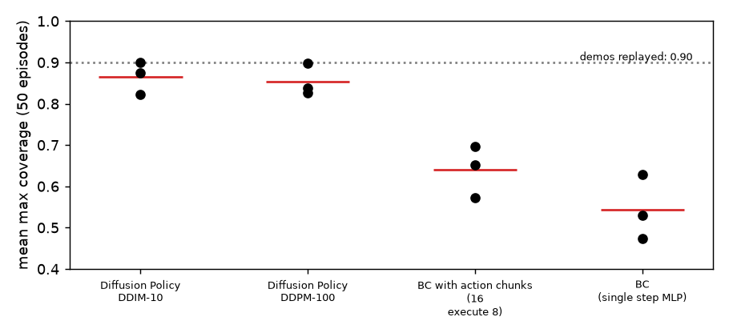

# diffusion-policy-pusht

Diffusion Policy written in plain PyTorch (1D conditional U-Net noise model, DDPM and DDIM samplers, receding-horizon action chunks) and compared with two behaviour-cloning baselines on the **state-based PushT** task: an MLP that predicts one action (`bc`) and an MLP that predicts the same 16-step action chunk as the diffusion model (`bcc`). Three seeds each, 50 evaluation episodes per seed. Every number below comes from `results/summary.md`, `results/summary.json`, `results/eval/*.json`, `results/replay_check.json`, `results/diagnose.json` or `logs/`.

**Live demo:** https://haiha-ux.github.io/diffusion-policy-pusht/ (the page in `docs/`). The two exported models run in your browser through onnxruntime-web 1.22.0; you drag the T or the agent and see action chunks sampled from the diffusion model. There is no physics in the page; the three GIFs on it are pre-rendered (details under Demo).

**Headline, stated plainly:** the diffusion policy is clearly ahead of both BC baselines in closed loop (mean max coverage 0.866 vs 0.640 and 0.544; the gap is several times the seed spread). Its paper-style score (0.907, DDIM-10) is in the neighbourhood of the 0.95 the original paper reports for state-based PushT, but I did not run the original code, used 40k training steps instead of the paper's far longer schedule, and the numbers are not a reproduction claim. The multimodality measurement I made is **weak** (see below): it does not show the diffusion policy representing clearly separate modes on held-out demo states.

## Setup

- **Data:** the public Diffusion Policy PushT demonstrations (`pusht_cchi_v7_replay.zarr`, 31 MB zip from the authors' site): 206 human episodes, 25,650 frames, state = (agent x, y, block x, y, block angle), action = absolute target position of the agent, 10 Hz. Only the low-dimensional arrays are used. Not committed (`data/` is git-ignored).
- **Simulator:** `gym-pusht` 0.1.8 (pymunk 6.11.1), `obs_type="state"`, episodes capped at 300 steps. Initial states are drawn like the reference environment (agent 50..450, block 100..400, angle uniform); the same 50 seeds (100000..100049) are used for every model.
- **Split:** 186 training episodes, 20 validation episodes (fixed episode-level split, `split_episodes`). The policies never see the 20 validation episodes; the paper trains on all of them, so my models see 10% less data.
- **Metrics (per episode):** *coverage* = maximum over the episode of the fraction of the goal T covered by the block (`info["coverage"]`); *paper-style score* = `min(max coverage / 0.95, 1)`, the quantity the paper averages; *success* = coverage above 0.95 at some step (the sim then terminates the episode). Per-seed value = mean over its 50 episodes, so a per-seed success rate is a count out of 50 and has a binomial standard error of roughly 0.07 by itself. Table entries are mean +- sample std (ddof=1) over the 3 seeds, per-seed values in brackets.

## Results

| Method | coverage (mean max over episode) | paper-style score | success rate (cov > 0.95) | successes per seed (of 50) |
|---|---|---|---|---|
| Diffusion Policy, DDIM-10 | 0.866 +- 0.039 (0.900, 0.874, 0.823) | 0.907 +- 0.041 (0.942, 0.915, 0.862) | 0.55 +- 0.08 | 27, 32, 24 |
| Diffusion Policy, DDPM-100 | 0.854 +- 0.038 (0.897, 0.827, 0.839) | 0.895 +- 0.040 (0.941, 0.867, 0.877) | 0.50 +- 0.09 | 24, 21, 30 |
| BC with action chunks (16, execute 8) | 0.640 +- 0.063 (0.572, 0.652, 0.696) | 0.671 +- 0.065 (0.600, 0.683, 0.729) | 0.25 +- 0.05 | 10, 14, 14 |
| BC (single-step MLP) | 0.544 +- 0.079 (0.474, 0.529, 0.629) | 0.570 +- 0.082 (0.497, 0.555, 0.659) | 0.27 +- 0.08 | 10, 13, 18 |



How to read it:

- **Diffusion vs BC is a real gap.** The worst diffusion seed (0.823 under DDIM-10) is above the best BC-chunk seed (0.696) and the best single-step seed (0.629). Success rate: 24 to 32 of 50 against 10 to 18 of 50.
- **DDIM-10 vs DDPM-100 is not distinguishable here.** 0.866 vs 0.854 is far inside the seed spread (std about 0.04); the per-seed ordering flips between seeds. The 10-step sampler is 10x cheaper, which is why the demo uses it.
- **BC with chunks vs single-step BC is probably better but not established.** 0.640 vs 0.544 with stds of 0.06 to 0.08 and 3 seeds; in success rate they are equal (0.25 vs 0.27). I would not claim chunking helps BC from this data.
- **Success is a hard threshold.** Replaying the human demonstrations' own actions open loop in the simulator (every 5th episode, 42 episodes, `replay_check.py`) gives a mean max coverage of only **0.90**, and only **7%** (3 of 42) of the replays exceed 0.95. So in this simulator a 0.95 success is hard even for the demonstrator's own action sequence, and the coverage and score columns are the more informative ones. The replay reproduces the recorded block trajectory to about 1e-5 px (median per-episode mean error), so this is not a physics mismatch; I did not find out why the demonstrations end at about 0.90 coverage under this sim's coverage formula (the goal pose I checked is correct: shifting it does not raise the demos' final coverage).
- **The coverage score is not "success".** Under closed loop, the diffusion policy exceeds 0.95 in about half the episodes even though open-loop replays rarely do; feedback corrects the block.

### Multimodality (the point of the paper), measured open loop

On 200 states sampled from the 20 held-out episodes, 16 chunks are drawn per state and the executed slice (8 steps; 1 for `bc`) is compared with the demonstrated one (mean over seeds, +- sample std):

| Method | endpoint spread (px) | single-sample error (px) | best-of-16 error (px) | states with 2 modes |
|---|---|---|---|---|
| Diffusion Policy, DDIM-10 | 3.19 +- 0.30 | 23.7 +- 0.4 | 19.3 +- 0.8 | 0.012 +- 0.003 |
| Diffusion Policy, DDPM-100 | 2.93 +- 0.27 | 23.8 +- 0.3 | 19.7 +- 0.4 | 0.002 +- 0.003 |
| BC with action chunks | 0 | 30.5 +- 0.8 | 30.5 +- 0.8 | 0 |
| BC (single step) | 0 | 10.5 +- 0.1 | 10.5 +- 0.1 | 0 |

"Endpoint spread" is the std of the last executed target position across the 16 samples (the workspace is 512 px wide); "2 modes" = a 2-means split of the 16 endpoints with both clusters holding 15 to 85% of the samples and centres more than 40 px apart (my own threshold, not from the paper). The single-sample errors of `bc` (1 executed step) and the other three (8 steps) are over different horizons and are not comparable with each other; only diffusion vs `bcc` is a like-for-like pair (23.7 vs 30.5 px).

What this does and does not show: the diffusion samples differ from each other (3 px of spread, nonzero where BC is exactly 0) and the best of 16 samples is about 4 px closer to the demonstration than a single sample, but a spread of 3 px on a 512 px workspace and a two-mode fraction of 0 to 1% mean that on these held-out states the model is **nearly unimodal**. I therefore cannot claim from this measurement that the diffusion policy captures distinct strategies; it may be that the demonstrations are mostly unimodal at an 8-step horizon, that 40k steps is too short to learn the modes, or that the held-out states simply rarely sit at a decision point. I did not distinguish between these. The better closed-loop score is therefore not demonstrated to come from multimodality; it may come from the chunked, smoothed action prediction, the noise-trained objective, or both. A direct test (a synthetic task with two known routes) was not done.

## What didn't work

1. **Multimodality did not show up in my measurement** (above). I expected to see separated groups of sampled paths at least at some states; the numbers say the samples are tight. The demo page lets you look for such states yourself; I have not looked at it in a browser.
2. **BC is poor and I checked that it is not a plumbing bug.** Single-step BC reaches 0.54 coverage. Before accepting that, `diagnose.py` rolled out 10 episodes x 30 steps for `bc_s0`, `bcc_s0` and `dp_s0` and compared the policy input with training: 1.3% (`bc`), 6% (`bcc`) and 0% (`dp`) of rollout observations fall outside the training min/max, the actions are 2-D absolute positions, and the action mean tracks the agent position. The means of rollout and training observations differ, but the rollout covers only the first 30 steps of episodes, which start from uniformly random agent positions, so that difference is expected rather than a normalisation fault. Independent checks: the unit tests (normalisation round trip, chunk alignment with edge padding, observation window order) and the simulator replay (action k applied to state k gives state k+1: agent position error about 1e-5 px). I found no bug; the low BC score looks like a real property of deterministic regression on 186 demonstrations, but I did not tune BC (one fixed MLP of 3x512, lr 1e-3, 40k steps), so a better-tuned BC could be closer than my table suggests.
3. **A simulator pitfall that would have invalidated everything.** `gym-pusht`'s own `reset_to_state` (and its reset) sets the block position before the angle, which with pymunk 6.11.1 moves the block by up to about 45 px; replays of the demonstrations then gave 0% success and a 91 px median block error. Setting the angle first (`set_state` in `ptlib.py`) matches the demonstrations (one-step block error 0.25 px median on moving steps). Rollout initial states use this order.
4. **Short training.** 40k steps at batch 256 (about 400 epochs of the 186 episodes) with lr 3e-4 and EMA; the paper's schedule is much longer and I did not run a longer one, so my diffusion numbers may be below what the method reaches. No hyperparameter sweep was done; one 2k-step smoke run was the only pilot (a longer pilot was started and stopped to start the grid).
5. **Held-out data only used for the open-loop metrics.** 10% of the demonstrations never reach the policies, and 3 seeds is too few for a significance test; none was done.
6. **Demo limits.** The page's paths are open loop with the agent assumed at rest and two identical observation frames; it is not a simulation.

## Method

| Part | Choice (all in `ptlib.py` / `train.py`) |
|---|---|
| Observation | 2 most recent frames of the 5-D state (older frame clamped at the episode start), min/max normalised to [-1, 1] |
| Action chunk | 16 absolute targets, normalised; diffusion chunk starts one frame before the current one and the executed slice is steps 1..8, so the executed actions are a_t..a_(t+7); BC chunk starts at a_t; edge frames are padded with the first/last action |
| Noise model | 1D conditional U-Net over the 16-step axis: widths 64/128/256, kernel 5, group norm, Mish, FiLM (scale and bias) from a sinusoidal timestep embedding concatenated with the flattened observation; 4.12 M parameters |
| Diffusion | 100 steps, squared-cosine beta schedule, epsilon prediction, MSE loss; sampling with DDPM (100 steps, fixed small variance) or deterministic DDIM (10 steps, eta 0); the predicted x0 is clipped to [-1, 1] at every step |
| BC | MLP 3x512 ReLU on the flattened observation, 0.53 M (`bc`, 1 action) or 0.55 M (`bcc`, 16 actions) parameters, MSE |
| Training | 40,000 steps, batch 256, AdamW (weight decay 1e-6), lr 3e-4 (diffusion) / 1e-3 (BC), 500 warm-up steps, cosine decay, EMA (decay up to 0.999) used for evaluation |
| Control | receding horizon: execute 8 actions (1 for `bc`), then re-plan from the last two observations |
| Compute | diffusion 697 to 1078 s per run, BC 44 to 118 s per run (`logs/*.time.json`); GPU capped at 30% memory, rollouts on CPU; the machine was shared, so timings are not clean |

## Demo

`docs/index.html` loads `dp_noise.onnx` (the seed-0 noise model, 8.3 MB) and `bc_chunk.onnx` (seed-0 `bcc`) with onnxruntime-web **pinned to 1.22.0** from jsdelivr. DDIM-10 is written in JavaScript (`docs/policy.js`, same maths as `ddim_sample`), batched over 12 samples. You can drag the agent, drag the T, and set the T angle; the page draws the 12 sampled chunks (thick = the 8 executed steps) and the BC chunk, and prints the sampling time.

**Live:** the model inference and sampling. **Pre-rendered:** the three GIFs (`docs/rollouts/`, simulator, seed-0 models, initial state seed 100000, the first evaluation state and not selected: diffusion reached coverage 0.946 without crossing 0.95, `bcc` 0.213, `bc` 0.0, in `docs/rollouts/manifest.json`). Not in the page: any physics.

To stay under the 10 MB per-file limit the U-Net weights are stored in fp16 and cast to fp32 inside the graph (`export_onnx.py`); this costs a maximum noise-prediction difference of 7e-4 against the fp32 PyTorch model (fp32 export parity: 1.9e-6; `docs/model.json` records both).

Checks done, including one pass in Chromium: the models load, dragging and the angle slider resample, and the paths draw.
- every file the page references returns 200 from `python -m http.server`, and the three onnxruntime-web 1.22.0 CDN files (`ort.min.js`, `ort-wasm-simd-threaded.wasm/.mjs`) return 200;
- `tests/node_check.js` (Node 20, onnxruntime-web 1.22.0): the JS DDIM from fixed noise matches the PyTorch fp32 sampler with a maximum difference of 1.55e-4 in normalised units; the chunked BC model also runs;
- `tests/page_smoke.js` runs the page's inline script under Node with a stubbed DOM and canvas and the real models: it loads both models, samples 12 chunks (about 0.5 s single-threaded in Node), and issues 310 line segments; pixels, pointer-event handling in a real browser, and CDN loading in a browser are not exercised.

## Reproduce

```bash
python3 -m venv .venv && .venv/bin/pip install -r requirements.txt     # versions used; torch 2.11.0 pulls the CUDA wheels (about 5 GB .venv)
# data: download https://diffusion-policy.cs.columbia.edu/data/training/pusht.zip, unzip to data/raw, then
.venv/bin/python -c "import zarr, numpy as np; z=zarr.open('data/raw/pusht/pusht_cchi_v7_replay.zarr','r'); np.savez('data/pusht_lowdim.npz', state=z['data/state'][:], action=z['data/action'][:], ends=z['meta/episode_ends'][:])"
PYTEST_DISABLE_PLUGIN_AUTOLOAD=1 .venv/bin/pytest -q tests              # 11 tests
.venv/bin/python replay_check.py                                          # results/replay_check.json
setsid nohup ./run_all.sh > logs/run_all.log 2>&1 < /dev/null &           # whole grid; resumable: run the same line again
.venv/bin/python summarize.py                                             # results/summary.md, summary.json, coverage.png
.venv/bin/python diagnose.py                                              # results/diagnose.json
.venv/bin/python export_onnx.py && .venv/bin/python make_gifs.py          # docs/*.onnx, docs/model.json, docs/rollouts/
.venv/bin/python tests/make_js_ref.py && ORT_DIR=/path/to/node_modules_dir node tests/node_check.js   # npm i onnxruntime-web@1.22.0
cd docs && python3 -m http.server                                          # local demo
```

The data-conversion one-liner is the only step not wrapped in a script; I ran the equivalent by hand. Runs are seeded; I have not checked bit-for-bit reproducibility across machines or between GPU and CPU. `data/` and `ckpt/` are not in the repository, so evaluation, export and the GIFs need the grid to be re-run first.

## Files

| File | Role |
|---|---|
| `ptlib.py` | Data, chunk indexing, normaliser, noise schedule, DDPM/DDIM, U-Net, BC MLP, policy wrapper, simulator state helpers |
| `train.py`, `eval.py`, `run_all.sh` | One training run; rollouts and open-loop metrics; the resumable grid |
| `summarize.py`, `diagnose.py`, `replay_check.py` | Tables and plot; input-path diagnostic; simulator-vs-demonstration check |
| `export_onnx.py`, `make_gifs.py` | ONNX export with parity checks; pre-rendered rollouts |
| `tests/` | `test_core.py` (11 pytest tests: schedule, sampling shape and range, DDIM recovering x0 with an exact noise model, normaliser round trip, chunk alignment, simulator state round trip, ...), `node_check.js`, `page_smoke.js`, `make_js_ref.py` |
| `results/`, `logs/` | Evaluation JSON per run, summary, plots, diagnostics; training curves and timings |
| `docs/` | The demo page and its models |

## License

MIT. Author: Ha Phan Thanh Hai. The demonstration data come from the Diffusion Policy authors' public release (MIT-licensed project).
